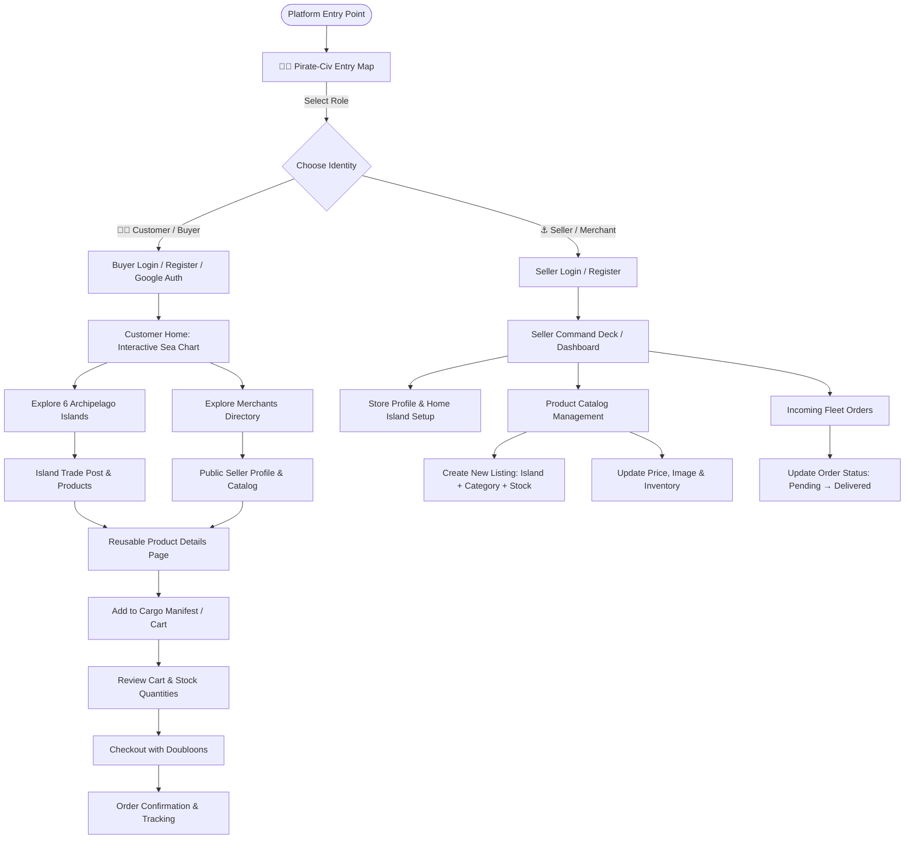

# 🏴‍☠️ 00_PROJECT_VISION — Pirate-Civ Vision & World Bible

## 1. Executive Summary

**Project Name:** Pirate-Civ  
**Project Type:** A pirate-themed two-sided e-commerce marketplace  
**Core Technologies:** Express 5, EJS, Node.js, MongoDB (Mongoose), Vanilla CSS & Modern JavaScript  
**Currency:** Doubloons (🪙)  

Pirate-Civ is an immersive, dark-fantasy, nautical e-commerce platform set in a 17th-century cartographic realm. Unlike standard modern e-commerce storefronts that rely on sterile, minimalist product grids, Pirate-Civ reimagines commerce as high-seas exploration. Buyers navigate uncharted archipelagos and maritime trade routes to discover rare goods sold by independent pirate merchants across the Seven Seas.

The platform is a **two-sided marketplace** serving two distinct user personas:
1. **The Customer / Buyer (Explorer / Buccaneer):** Discovers islands via an interactive hand-drawn sea chart, browses unique inventories, inspects dynamic product details, adds items to their ship manifest (cart), checks out, and tracks high-seas shipments.
2. **The Seller / Merchant (Armator / Smuggler Guildmaster):** Establishes an island merchant identity, provisions a store, catalogs maritime artifacts and provisions across specific islands and trading categories, manages inventory stocks, and fulfills incoming fleet orders.

---

## 2. Core User Experience & End-to-End Flows



### 2.1 The Customer (Buyer) Journey
1. **Entry & Onboarding:** Arrives at the platform gateway, selects **Customer**, registers or logs in (via email/password or Google OAuth with optional "Remember Me" credential preservation).
2. **Navigation & World Discovery:** Lands on the interactive Imperial Sea Chart ("Terra Incognita"), an animated canvas featuring burnt parchment, brass compasses, drifting embers, and trade-wind telemetry.
3. **Island Exploration:** Drills down from the Capital (Grand Bazaar) through major trading branches into one of the **6 leaf islands**.
4. **Product Discovery:** Views curated products tagged to that specific island. Can also visit the "Explore Sellers" directory to discover merchants and view their dedicated merchant profiles.
5. **Product Detail:** Inspects a shared dynamic Product Details view (`/product/:productId`) displaying seller affiliation, Doubloons price, stock level, customer reviews, lore, and action to add to cargo.
6. **Cargo Manifest (Cart) & Checkout:** Reviews cart items stored persistently in the database, adjusts quantities within stock limits, provides shipping coordinates, and places an order.
7. **Order Tracking:** Monitors the lifecycle of their purchase through a customer order dashboard (Statuses: `pending`, `confirmed`, `processing`, `shipped`, `delivered`, `cancelled`).

### 2.2 The Seller (Merchant) Journey
1. **Entry & Merchant Onboarding:** Selects **Seller** on the entry map, completes merchant registration (defining merchant name, store handle, bio, and home island).
2. **Command Deck (Dashboard):** Accesses a private command center showcasing store metrics: active listings, current stock levels, incoming orders, and revenue in Doubloons.
3. **Catalog Management (CRUD):** 
   - Proposes new products by selecting one of the **6 official islands** and one of the **3 major trading branches/categories**.
   - Defines name, description, image, Doubloons price, and available inventory.
   - Updates existing listings or marks them out of stock.
   - Deletes obsolete listings (with ownership strictly validated by backend authorization).
4. **Order Fulfillment:** Views incoming customer orders containing items from their catalog, transitions order status as cargo is packed, boarded, and delivered across the straits.

---

## 3. The Pirate-Civ World Structure & Cartographic Lore

The Pirate-Civ universe is mapped as a cartographic hierarchy verified directly from the codebase:

```
                          [ Grand Bazaar ]
                     (Capital of the Seven Seas)
                             /         \
                            /           \
                           /             \
             [ Isle of Ancient Relics ]   [ Port of Corsair Apparel ]
              (Trade Branch: Relics)      (Trade Branch: Apparel/Goods)
                     /   |   \                   /   |   \
                    /    |    \                 /    |    \
                   /     |     \               /     |     \
         [Astrolabe] [Chronos] [Kraken's]  [Cutlass] [Velvet] [Booty]
            Atoll       Cay      Vault       Cove     Isle     Cay
```

### 3.1 The Capital
* **The Grand Bazaar:** The sovereign trade capital of merchant corsairs, black-market cartographers, and buccaneer armators. Acts as the root node of the interactive Sea Chart mind map.

### 3.2 The Three Major Trading Branches
The marketplace branches into primary trade domains:
1. **Isle of Ancient Relics (Expedition & Curios):** Celestial instruments, horological artifacts, and abyssal relics retrieved from ocean trenches.
2. **Port of Corsair Apparel (Buccaneer Ware & Living):** High-grade weapons, tech essentials, textiles, and luxurious island goods.
3. **Provisions & Curiosities Guild (Treasury & Potions):** Specialized trade guild governing grooming, elixirs, cosmetics, and rare bullion.

### 3.3 The 6 Official Leaf Islands
Every product in Pirate-Civ belongs to exactly one of the 6 canonical leaf islands:

1. **Astrolabe Atoll (`astrolabe`)**
   - *Theme:* Astronomical & Celestial Navigation Instruments.
   - *Lore:* Perched upon a calcified coral ring in the northern straits, home to exiled royal astronomers charting forbidden occult trade winds. Seville brass sextants, sunstone compasses, and star scrolls.
   - *Coordinates:* `18°42'N, 64°31'W` | *Trade Wind:* `ENE 18 Knots` | *Danger:* Low (Guarded by Cartographer Guild).

2. **Chronos Cay (`chronos`)**
   - *Theme:* Horology & Footwear from across time.
   - *Lore:* Temporal fog squalls shroud an island where clockmakers and shoemakers craft resilient boots and gimbaled marine chronometers tuned in whale-oil baths.
   - *Coordinates:* `14°18'N, 71°22'W` | *Trade Wind:* `NE 14 Knots` | *Danger:* Moderate (Temporal Fog Squalls).

3. **Kraken's Vault (`kraken_vault`)**
   - *Theme:* Abyssal Relics & Sunken Curiosities.
   - *Lore:* Deep ocean trench glowing with cold blue bioluminescence. Salvaged Spanish escudos, tentacle-wrought silver rings, and eldritch amulets dredged from 200 fathoms.
   - *Coordinates:* `09°55'N, 79°58'W` | *Trade Wind:* `SW 24 Knots` | *Danger:* High (Abyssal Trench Creatures).

4. **Cutlass Cove (`cutlass_cove`)**
   - *Theme:* Weaponry, Tools & Corsair Electronics.
   - *Lore:* Blacksmith bastions where carbon steel boarding sabres, main-gauche daggers, and high-performance explorer gadgets are forged and tuned.
   - *Coordinates:* `22°15'N, 83°40'W` | *Trade Wind:* `E 20 Knots` | *Danger:* Moderate (Corsair Blacksmith Bastion).

5. **Velvet Isle (`velvet_isle`)**
   - *Theme:* Home & Living, Vestments & Serene Furnishings.
   - *Lore:* Serene haven behind cascading waterfall arches. Master artisans weave brocade longcoats, rattan furnishings, teak wood tables, and coastal lanterns.
   - *Coordinates:* `12°04'N, 68°14'W` | *Trade Wind:* `SE 16 Knots` | *Danger:* Low (Serene Haven Resort).

6. **Booty Cay (`booty_cay`)**
   - *Theme:* Treasury, Beauty, Fragrances & Oceanic Elixirs.
   - *Lore:* Hidden cove behind Skull Mountain. Luminous pearls, tropical botanical serums, matte lipsticks, silver rum flasks, and kraken-bone dice.
   - *Coordinates:* `16°30'N, 88°20'W` | *Trade Wind:* `ENE 12 Knots` | *Danger:* Low (Enchanted Skull Cove Retreat).

*Note: No additional islands shall be invented without architectural approval.*

---

## 4. Guiding Principles of the Pirate-Civ Vision

1. **Immersion Without Compromising Usability:** Pirate flavor, atmospheric audio-visual cues, parchment textures, and brass motifs enrich the user experience but must never obstruct navigation, checkout clarity, or responsive performance.
2. **True Two-Sided Marketplace:** The platform is not a static catalog; it is an active market where merchants have autonomy over their listings and buyers engage with authentic seller identities.
3. **Unified Codebase:** Built around clean MVC principles in Express 5, server-rendered EJS templates with rich client-side micro-interactions, and a resilient MongoDB persistence layer.
