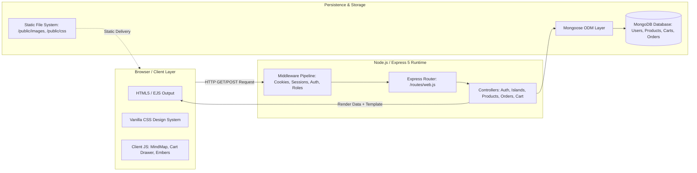
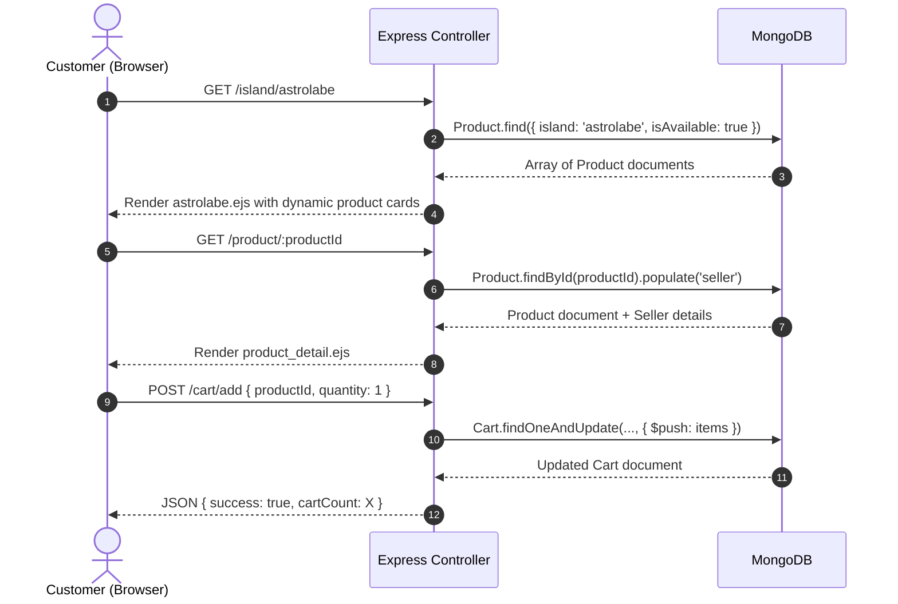
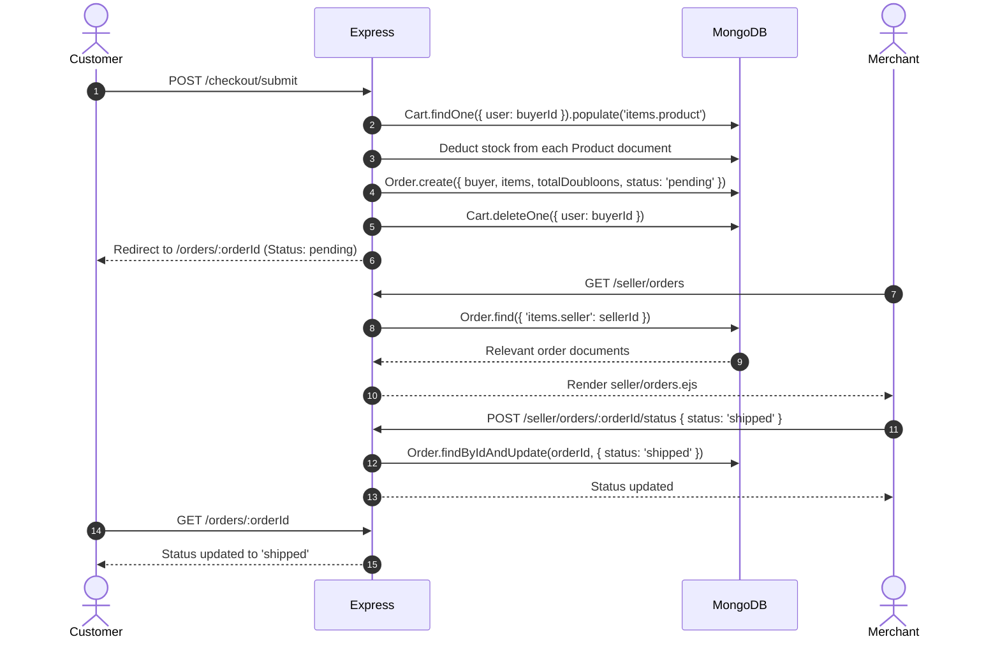

# 🏴‍☠️ 03_ARCHITECTURE — System Architecture & Design

## 1. Architectural Philosophy & Technology Stack

Pirate-Civ is built on a clean, robust **Model-View-Controller (MVC)** pattern running on modern **Express 5** and **Node.js** with ES Module syntax (`import`/`export`), server-rendered **EJS** views, and persistent **MongoDB** backed by Mongoose.

```
┌────────────────────────────────────────────────────────────────────────┐
│ ARCHITECTURAL DIRECTIVE:                                               │
│ Pirate-Civ is intentionally engineered with Express 5 + EJS.           │
│ Under NO circumstances should the project be rewritten into React,    │
│ Next.js, or SPA frameworks unless explicitly instructed by the user.  │
│ The server-rendered EJS architecture delivers fast initial loads,      │
│ SEO advantages, and authentic parchment aesthetics without framework  │
│ overhead.                                                              │
└────────────────────────────────────────────────────────────────────────┘
```

---

## 2. High-Level System Architecture



---

## 3. Structural Layers

### 3.1 Presentation Layer (Views & Templates)
* **Template Engine:** EJS (Embedded JavaScript) configured via `server.set("view engine", "ejs")`.
* **Template Structure:**
  - `views/partials/`: Shared components (`header.ejs`, `footer.ejs`, cart drawer, toasts).
  - `views/`: Core pages (`home.ejs`, `login.ejs`, `register.ejs`, `product_detail.ejs`, `contact.ejs`, `about.ejs`).
  - `views/islands/`: The 6 leaf island forwarder templates.
  - `views/seller/`: Merchant command deck and product editing views.
* **Styling:** Modular Vanilla CSS in `/public/css/` utilizing custom properties (tokens) for parchment tones, brass accents, dark leather backgrounds, and embers.
* **Client-Side Scripts:** Vanilla JavaScript in `/public/js/` managing micro-animations (smoke, fire embers, lantern cursor following, and the mind map voyage curve engine).

### 3.2 Request & Middleware Pipeline
1. `express.urlencoded({ extended: true })` — Decodes incoming form bodies.
2. `express.json()` — Decodes incoming asynchronous API requests (cart updates).
3. `cookieParser(process.env.COOKIE_SECRET)` — Parses and cryptographically validates signed cookies (`auth_token`).
4. `session({ ... })` — Configures secure HTTP-only session cookies with 7-day or 30-day lifespans.
5. `authMiddleware` — Authenticates incoming sessions against signed cookies and MongoDB user secret hashes.
6. `roleMiddleware` — Enforces role-based access control (`requireRole('seller')`, `requireRole('buyer')`).

### 3.3 Routing Layer (`/routes`)
* Centralized in `routes/web.js` (and modular sub-routers as the platform expands into `/routes/seller.js` and `/routes/api.js`).
* Connects HTTP verbs (`GET`, `POST`, `PUT`, `DELETE`) to dedicated controller actions with explicit middleware guards.

### 3.4 Controller Layer (`/controller`)
Controllers contain business logic, coordinate models, and render views or return JSON responses:
* `auth.js`: User registration, credential verification, session creation, logout, and token hashing.
* `islands.js`: Fully integrated with MongoDB in Milestone 2.6; queries `Product.find({ island, isAvailable: true })` and injects live products into themed island views while preserving static cartographic lore.
* `products.js`: Handles product detail rendering, merchant CRUD operations, and inventory validations.
* `cart.js`: Manages adding, updating, and removing items in the database-backed cart.
* `orders.js`: Manages order checkout, creation, buyer tracking, and seller status transitions.
* `contact.js`: Validates and saves inbound customer messages into MongoDB.

### 3.5 Data & Persistence Layer (`/models` & `/config`)
* **ODM:** Mongoose v8/v9 with strict schemas, validation rules, timestamps, and foreign key references (`ref`).
* **Connection:** Singleton connection in `config/db.js` with auto-reconnect and graceful error shutdown.
* **Collections:** `users`, `products`, `carts`, `orders`, `contacts`.

---

## 4. Key Data Flows

### 4.1 Product Discovery to Cargo Flow


### 4.2 Order Placement & Merchant Fulfillment Flow


---

## 5. Security & Session State Architecture

* **Unified Authentication Mechanism:** Sessions and signed cookies are cross-checked against a cryptographic SHA-256 digest (`authSecretHash`) stored in the User record. If cookie token and database hash mismatch, the session is invalidated instantly.
* **Role Verification:** Role authorization is enforced strictly on the server:
  - Buyer trying to access `/seller/*` is redirected with a 403 Forbidden.
  - Seller modifying products is checked via `product.seller.equals(req.user._id)`.
* **Zero Trust Frontend:** Frontend displays and hides buttons for UX convenience, but all mutations are guarded by backend controllers.
