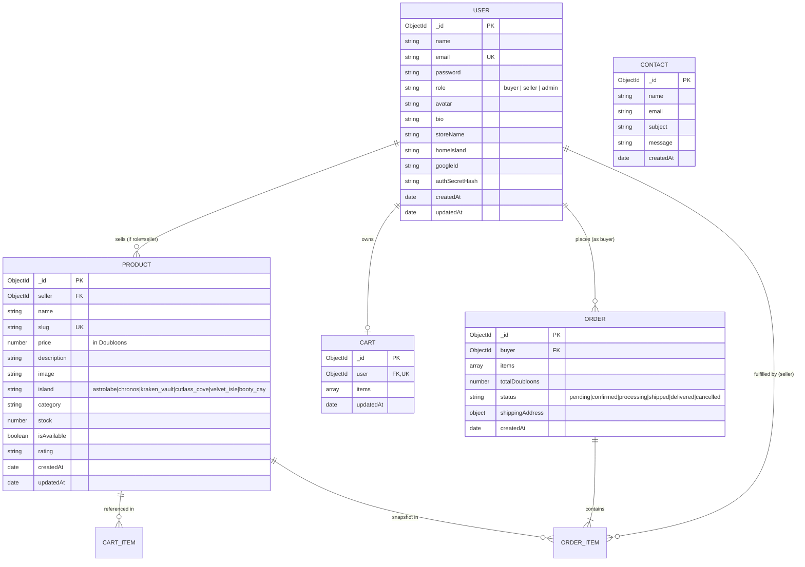

# 🏴‍☠️ 04_DATABASE_DESIGN — Database Schema & Data Modeling

This document defines the official MongoDB schema specifications for Pirate-Civ via Mongoose ODM.

```
┌────────────────────────────────────────────────────────────────────────┐
│ CRITICAL DESIGN DECISION (Decision 001):                               │
│ Do NOT create separate authentication models for Buyers and Sellers    │
│ (e.g. no 'Buyer' model and separate 'Seller' model).                   │
│ Pirate-Civ utilizes a UNIFIED User model with a 'role' field.          │
│ This prevents redundant authentication pipelines, simplifies session   │
│ management, and allows seamless account transitions.                   │
└────────────────────────────────────────────────────────────────────────┘
```

---

## 1. Entity-Relationship Diagram (ERD)



---

## 2. Detailed Schema Specifications

### 2.1 The Unified User Collection (`models/user.js`)
Represents all system users (Buyers, Sellers, Admins).

```javascript
const userSchema = new mongoose.Schema({
    name: {
        type: String,
        required: [true, "Please provide your pirate name or alias"],
        trim: true
    },
    email: {
        type: String,
        required: [true, "Please provide an email address"],
        unique: true,
        lowercase: true,
        trim: true,
        index: true
    },
    password: {
        type: String,
        required: function() { return !this.googleId; } // optional if registered via Google OAuth
    },
    role: {
        type: String,
        enum: ["buyer", "seller", "admin"],
        default: "buyer",
        index: true
    },
    avatar: {
        type: String,
        default: "/images/avatars/default-pirate.png"
    },
    // Merchant Profile Fields (Active when role === 'seller')
    storeName: {
        type: String,
        trim: true,
        default: null
    },
    bio: {
        type: String,
        trim: true,
        maxlength: 500,
        default: ""
    },
    homeIsland: {
        type: String,
        enum: ["astrolabe", "chronos", "kraken_vault", "cutlass_cove", "velvet_isle", "booty_cay", null],
        default: null
    },
    // Authentication & Security Digits
    googleId: {
        type: String,
        sparse: true,
        unique: true
    },
    authSecretHash: {
        type: String,
        required: true
    }
}, {
    timestamps: true
});
```

### 2.2 The Product Collection (`models/product.js`)
Represents items listed across the 6 islands and trading categories.

```javascript
const productSchema = new mongoose.Schema({
    seller: {
        type: mongoose.Schema.Types.ObjectId,
        ref: "User",
        required: true,
        index: true
    },
    name: {
        type: String,
        required: [true, "Product name is required"],
        trim: true
    },
    slug: {
        type: String,
        required: true,
        unique: true,
        lowercase: true,
        index: true
    },
    price: {
        type: Number,
        required: [true, "Price in Doubloons is required"],
        min: [1, "Price must be at least 1 Doubloon"]
    },
    description: {
        type: String,
        required: [true, "Product description is required"],
        trim: true
    },
    image: {
        type: String,
        required: [true, "Product image path is required"],
        default: "/images/items/default-relic.png"
    },
    island: {
        type: String,
        required: [true, "Product must belong to an official island"],
        enum: [
            "astrolabe",
            "chronos",
            "kraken_vault",
            "cutlass_cove",
            "velvet_isle",
            "booty_cay"
        ],
        index: true
    },
    category: {
        type: String,
        required: true,
        trim: true,
        index: true
    },
    stock: {
        type: Number,
        required: true,
        default: 10,
        min: [0, "Stock cannot be negative"],
        validate: {
            validator: Number.isInteger,
            message: "Stock must be an integer value"
        }
    },
    isAvailable: {
        type: Boolean,
        default: true,
        index: true
    },
    rating: {
        type: String,
        default: "★★★★★"
    }
}, {
    timestamps: true
});

// Compound Indexes:
// 1. { island: 1, isAvailable: 1 } -> Fast island shop filtering
// 2. { seller: 1, createdAt: -1 }   -> Fast merchant product catalog queries
productSchema.index({ island: 1, isAvailable: 1 });
productSchema.index({ seller: 1, createdAt: -1 });
```

### 2.3 The Cart Collection (`models/cart.js`)
Maintains server-persisted shopping bags for authenticated buyers.

```javascript
const cartItemSchema = new mongoose.Schema({
    product: {
        type: mongoose.Schema.Types.ObjectId,
        ref: "Product",
        required: true
    },
    quantity: {
        type: Number,
        required: true,
        min: 1,
        default: 1
    }
}, { _id: false });

const cartSchema = new mongoose.Schema({
    user: {
        type: mongoose.Schema.Types.ObjectId,
        ref: "User",
        required: true,
        unique: true,
        index: true
    },
    items: [cartItemSchema]
}, {
    timestamps: true
});
```

### 2.4 The Order Collection (`models/order.js`)
Captures transactions, snapshot pricing, buyer information, and multi-item seller references.

```javascript
const orderItemSchema = new mongoose.Schema({
    product: {
        type: mongoose.Schema.Types.ObjectId,
        ref: "Product",
        required: true
    },
    seller: {
        type: mongoose.Schema.Types.ObjectId,
        ref: "User",
        required: true,
        index: true
    },
    name: { type: String, required: true },
    price: { type: Number, required: true }, // Doubloons at purchase time
    quantity: { type: Number, required: true, min: 1 },
    image: { type: String }
}, { _id: false });

const orderSchema = new mongoose.Schema({
    buyer: {
        type: mongoose.Schema.Types.ObjectId,
        ref: "User",
        required: true,
        index: true
    },
    items: [orderItemSchema],
    totalDoubloons: {
        type: Number,
        required: true,
        min: 0
    },
    status: {
        type: String,
        enum: ["pending", "confirmed", "processing", "shipped", "delivered", "cancelled"],
        default: "pending",
        index: true
    },
    shippingAddress: {
        portName: { type: String, required: true },
        islandCoordinates: { type: String, default: "18°42'N, 64°31'W" },
        recipientNotes: { type: String, default: "" }
    }
}, {
    timestamps: true
});
```

### 2.5 The Contact Collection (`models/contact.js`)
Existing active collection capturing customer inquiries.

```javascript
const contactSchema = new mongoose.Schema({
    name: { type: String, required: true, trim: true },
    email: { type: String, required: true, trim: true, lowercase: true },
    subject: { type: String, required: true, trim: true },
    message: { type: String, required: true }
}, {
    timestamps: true
});
```

---

## 3. Database Indexes & Performance Strategy

1. **Compound Indexes:**
   - `Product.index({ island: 1, isAvailable: 1 })` — Optimizes rendering island product lists.
   - `Product.index({ seller: 1, isAvailable: 1 })` — Optimizes seller profile storefronts.
   - `Order.index({ buyer: 1, createdAt: -1 })` — Optimizes customer order history sorting.
   - `Order.index({ "items.seller": 1, status: 1 })` — Optimizes merchant order fulfillment queues.
2. **Slug Uniqueness:**
   - Products enforce unique, URL-safe slugs generated from product names.
3. **Referential Integrity:**
   - When a product is soft-deleted or marked unavailable (`isAvailable: false`), active cart items are flagged with out-of-stock notices instead of breaking cart views.
