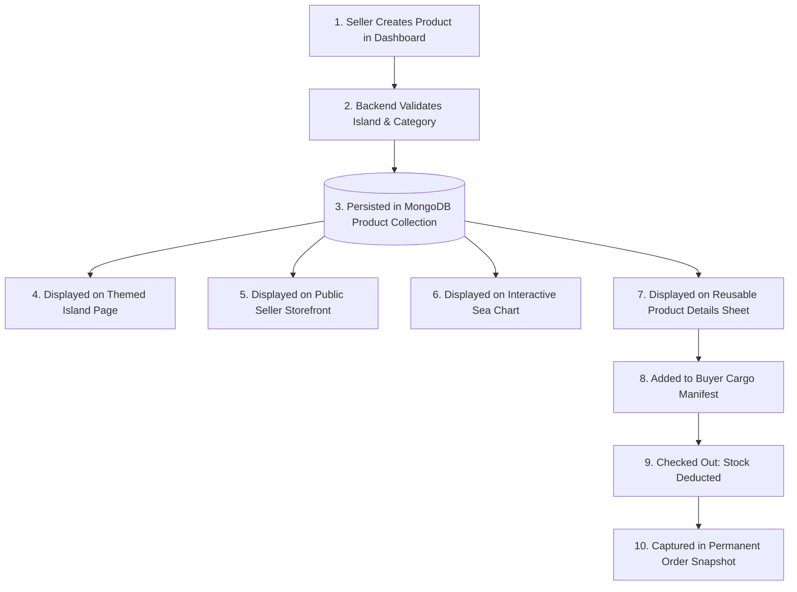

# 🏴‍☠️ 10_PRODUCT_SYSTEM — Product Architecture & Catalog Lifecycle

This document defines the product lifecycle, database-as-source-of-truth mandate, and the controlled migration/seed protocol for migrating hardcoded products into MongoDB.

---

## 1. Product Lifecycle



---

## 2. Database as Single Source of Truth

```
┌────────────────────────────────────────────────────────────────────────┐
│ ARCHITECTURAL MANDATE (Decision 003):                                  │
│ The MongoDB database is the SOLE source of truth for marketplace data. │
│ Never hardcode product arrays in frontend JavaScript files, and never  │
│ duplicate product dictionaries between controllers and client scripts. │
│ Client-side components (like the sea chart mind map) must receive      │
│ product counts and data dynamically serialized from Express.           │
└────────────────────────────────────────────────────────────────────────┘
```

---

## 3. Product Catalog Taxonomy

Every product in Pirate-Civ is classified by two axes:

### Axis 1: The 6 Canonical Islands
1. `astrolabe`: Astrolabe Atoll (Instruments, Navigational Curios)
2. `chronos`: Chronos Cay (Horology, Timepieces, Footwear)
3. `kraken_vault`: Kraken's Vault (Abyssal Relics, Sunken Artifacts)
4. `cutlass_cove`: Cutlass Cove (Weaponry, Corsair Electronics, Tools)
5. `velvet_isle`: Velvet Isle (Home & Living, Textiles, Furnishings)
6. `booty_cay`: Booty Cay (Treasury, Beauty, Fragrances, Elixirs)

### Axis 2: The 3 Major Trading Branches
1. **Ancient Relics & Instruments:** Astrolabe & Chronos & Kraken's Vault.
2. **Corsair Apparel & Modern Gear:** Cutlass Cove & Velvet Isle.
3. **Provisions, Treasury & Elixirs:** Booty Cay.

### 3.1 Product Database Schema (`models/product.js`)
* **`seller`:** `mongoose.Schema.Types.ObjectId`, `ref: 'User'`, required, indexed.
* **`name`:** `String`, required, trimmed, max 120 characters.
* **`slug`:** `String`, required, unique, lowercase, trimmed, indexed (auto-generated in kebab-case from name if omitted).
* **`price`:** `Number` in Doubloons (🪙), required, non-negative (`min: 0`).
* **`description`:** `String`, required, trimmed, max 2000 characters.
* **`image`:** `String`, required, default: `"/images/items/default-relic.png"`.
* **`island`:** `String`, required, enum: `CANONICAL_ISLANDS` (6 islands), indexed.
* **`category`:** `String`, required, trimmed, indexed.
* **`stock`:** `Number`, required, default 10, integer validation, non-negative (`min: 0`).
* **`isAvailable`:** `Boolean`, default `true`, indexed.
* **`rating`:** `String`, default `"★★★★★"`.
* **`timestamps`:** `createdAt` and `updatedAt` enabled.
* **Compound Indexes:**
  - `{ island: 1, isAvailable: 1 }`: Fast retrieval of active items on themed island pages.
  - `{ seller: 1, createdAt: -1 }`: Fast merchant inventory lookup.

---

## 4. Controlled Product Migration & Seeding Strategy

Currently, 28+ products are hardcoded inside `controller/islands.js` (`ISLANDS_DATA`) and `public/js/mindmap.js` (`REALM_DATA`).

```
┌────────────────────────────────────────────────────────────────────────┐
│ MIGRATION DIRECTIVE (Decision 007):                                    │
│ Existing Pirate-Civ products must NOT simply disappear or be wiped.    │
│ During Phase 2, a controlled migration/seed script must import every   │
│ existing product from the audit into MongoDB, attributing them to a   │
│ canonical seed merchant ("The Grand Admiralty Guild").                 │
└────────────────────────────────────────────────────────────────────────┘
```

### 4.1 Seed Script Execution Plan (`scripts/seedProducts.js`)
1. **Merchant Bootstrap:** Check if default seed merchant exists:
   - Name: *"Grand Admiralty Cartographers"*
   - Store Name: *"Imperial Admiralty Vault"*
   - Email: `admiralty@pirate-civ.internal`
   - Role: `seller`
   - Home Island: `astrolabe`
2. **Catalog Transformation:** Extract all items from `ISLANDS_DATA` in `controller/islands.js`:
   - Map `price` strings (`"24,999"`) into clean integers (`24999`).
   - Assign initial stock (`stock: 15`).
   - Ensure clean image paths (`/images/items/...`).
   - Associate each document with the seed merchant's `_id`.
3. **Idempotent Upsert:** Execute `Product.bulkWrite(...)` using unique slugs to ensure the script can be run repeatedly without duplicating products.
4. **Verification:** Confirm that `/island/astrolabe`, `/island/chronos`, `/island/kraken_vault`, `/island/cutlass_cove`, `/island/velvet_isle`, and `/island/booty_cay` render the exact catalog directly from MongoDB.

---

## 5. Currency & Pricing: Doubloons (🪙)

* All product prices are denominated strictly in **Doubloons (🪙)**.
* Prices are positive integers stored in the database as numbers.
* Frontend formatting renders Doubloons with comma separation (e.g., `24,999 🪙`).
* No fractional cents or fiat currencies (USD/EUR) exist in the Pirate-Civ world.
