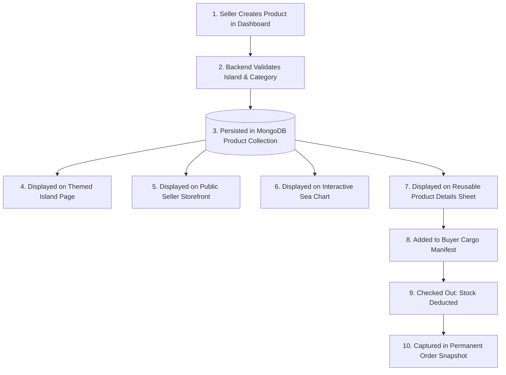

# 🏴‍☠️ 10_PRODUCT_SYSTEM — Product Architecture & Catalog Lifecycle

This document defines the product lifecycle, database-as-source-of-truth mandate, and the controlled migration/seed protocol for migrating hardcoded products into MongoDB.

---

## 1. Product Lifecycle



---

## 2. Database as Single Source of Truth

```
┌────────────────────────────────────────────────────────────────────────┐
│ ARCHITECTURAL MANDATE (Decision 003):                                  │
│ The MongoDB database is the SOLE source of truth for marketplace data. │
│ Never hardcode product arrays in frontend JavaScript files, and never  │
│ duplicate product dictionaries between controllers and client scripts. │
│ Client-side components (like the sea chart mind map) must receive      │
│ product counts and data dynamically serialized from Express.           │
└────────────────────────────────────────────────────────────────────────┘
```

---

## 3. Product Catalog Taxonomy

Every product in Pirate-Civ is classified by two axes:

### Axis 1: The 6 Canonical Islands
1. `astrolabe`: Astrolabe Atoll (Instruments, Navigational Curios)
2. `chronos`: Chronos Cay (Horology, Timepieces, Footwear)
3. `kraken_vault`: Kraken's Vault (Abyssal Relics, Sunken Artifacts)
4. `cutlass_cove`: Cutlass Cove (Weaponry, Corsair Electronics, Tools)
5. `velvet_isle`: Velvet Isle (Home & Living, Textiles, Furnishings)
6. `booty_cay`: Booty Cay (Treasury, Beauty, Fragrances, Elixirs)

### Axis 2: The 3 Major Trading Branches
1. **Ancient Relics & Instruments:** Astrolabe & Chronos & Kraken's Vault.
2. **Corsair Apparel & Modern Gear:** Cutlass Cove & Velvet Isle.
3. **Provisions, Treasury & Elixirs:** Booty Cay.

### 3.1 Product Database Schema (`models/product.js`)
* **`seller`:** `mongoose.Schema.Types.ObjectId`, `ref: 'User'`, required, indexed.
* **`name`:** `String`, required, trimmed, max 120 characters.
* **`slug`:** `String`, required, unique, lowercase, trimmed, indexed (auto-generated in kebab-case from name if omitted).
* **`price`:** `Number` in Doubloons (🪙), required, non-negative (`min: 0`).
* **`description`:** `String`, required, trimmed, max 2000 characters.
* **`image`:** `String`, required, default: `"/images/items/default-relic.png"`.
* **`island`:** `String`, required, enum: `CANONICAL_ISLANDS` (6 islands), indexed.
* **`category`:** `String`, required, trimmed, indexed.
* **`stock`:** `Number`, required, default 10, integer validation, non-negative (`min: 0`).
* **`isAvailable`:** `Boolean`, default `true`, indexed.
* **`rating`:** `String`, default `"★★★★★"`.
* **`timestamps`:** `createdAt` and `updatedAt` enabled.
* **Compound Indexes:**
  - `{ island: 1, isAvailable: 1 }`: Fast retrieval of active items on themed island pages.
  - `{ seller: 1, createdAt: -1 }`: Fast merchant inventory lookup.

### 3.2 Seller ↔ Product Relationship Foundation
* **Seller Ownership:** Every product references a merchant user via `seller: { type: ObjectId, ref: 'User', required: true }`.
* **Unified Merchant Persona:** The merchant is represented directly in the unified `User` model with `role: "seller"`. No separate `Seller` collection exists.
* **Query Foundation:**
  - Standard Mongoose: `Product.find({ seller: sellerId })`
  - Static Helper: `Product.findBySeller(sellerId, [filter])` queries items owned by the seller sorted by `createdAt: -1`, taking advantage of the `{ seller: 1, createdAt: -1 }` compound index.
  - Isolation: Querying Seller A never returns Seller B's items. Valid sellers with no products return `[]`.
* **Ownership Verification Method:**
  - Instance Helper: `product.isOwnedBy(userOrId)` safely performs ObjectId comparison whether `seller` is an unpopulated ObjectId or a populated User document.
* **Population & Security:**
  - `Product.findById(id).populate('seller', '-password -authSecretHash')` resolves merchant profile details (`name`, `storeName`, `email`, `role`) while strictly omitting sensitive authentication hashes.

---

## 4. Controlled Product Migration & Seeding Strategy (Milestone 2.5 COMPLETE)

Historically, 32 products were hardcoded inside `controller/islands.js` (`ISLANDS_DATA`) across the 6 islands, with 13 simplified nodes in `public/js/mindmap.js` (`REALM_DATA`).

```
┌────────────────────────────────────────────────────────────────────────┐
│ MIGRATION DIRECTIVE (Decision 007 & Milestone 2.5):                    │
│ Existing Pirate-Civ products must NOT simply disappear or be wiped.    │
│ Milestone 2.5 implemented a dedicated, idempotent migration script     │
│ (`scripts/seedProducts.js`) that safely imports all 32 products into   │
│ MongoDB under canonical merchant "Grand Admiralty Cartographers".      │
└────────────────────────────────────────────────────────────────────────┘
```

### 4.1 Seed Script Implementation (`scripts/seedProducts.js`)
1. **Canonical Merchant Bootstrap:**
   - Name: *"Grand Admiralty Cartographers"*
   - Store Name: *"Grand Admiralty Cartographers"*
   - Email: `admiralty@pirate-civ.internal`
   - Role: `seller`
   - Home Island: `astrolabe`
   - Implementation: Queries existing user via `User.findOne({ email })`; creates merchant if not found. Idempotent across multiple runs.
2. **Catalog Extraction & Transformation:**
   - 32 items extracted from `ISLANDS_DATA` in `controller/islands.js`.
   - Prices: String formats (e.g., `"24,999"`) converted into clean positive integers (`24999`).
   - Stock: Seeded with baseline default `stock: 15`. Subsequent runs preserve existing database stock.
   - Images: Relative paths (`/images/items/*.png`) preserved directly.
   - Ratings: Preserved as visual formatted strings (`"★★★★★"`, `"★★★★☆"`).
   - Slugs: Deterministically generated from product names using URL-safe kebab-case. 100% unique across all 32 items.
   - Taxonomy:
     - Islands: `astrolabe`, `chronos`, `kraken_vault`, `cutlass_cove`, `velvet_isle`, `booty_cay`.
     - Categories: `relics` (`astrolabe`, `chronos`, `kraken_vault`), `apparel` (`cutlass_cove`, `velvet_isle`), `provisions` (`booty_cay`).
3. **Idempotent Upsert Strategy:**
   - Pre-validates documents against the Mongoose `Product` model schema.
   - Finds existing product by `{ slug }`. If found, updates attributes while preserving existing stock. If not found, creates product.
   - Never calls destructive operations (`deleteMany({})`).
4. **Verification Results:**
   - First run on clean DB: 32 created, 0 updated, 0 failed.
   - Second run on seeded DB: 0 created, 32 updated, 0 failed. Total product count remains exactly 32.
   - Verified 100% seller ownership under `Grand Admiralty Cartographers`.
   - Verified SSR hydration readiness for Milestone 2.6.

### 4.2 Runtime Database Integration & SSR Flow (Milestone 2.6 COMPLETE)
1. **Single Source of Truth:** `renderIslandPage` in `controller/islands.js` queries `Product.find({ island: normalizedKey, isAvailable: true })`.
2. **EJS Compatibility:** DB documents are projected with `id`, `name`, `price`, `desc`, `image`, `rating`, `island`, `category`, ensuring 100% template compatibility.
3. **Inventory Integrity:** Read operations strictly preserve `Product.stock`.
4. **Verification:** Verified all 6 island pages render real MongoDB products via HTTP test server.

---

## 5. Currency & Pricing: Doubloons (🪙)

* All product prices are denominated strictly in **Doubloons (🪙)**.
* Prices are positive integers stored in the database as numbers.
* Frontend formatting renders Doubloons with comma separation (e.g., `24,999 🪙`).
* No fractional cents or fiat currencies (USD/EUR) exist in the Pirate-Civ world.
