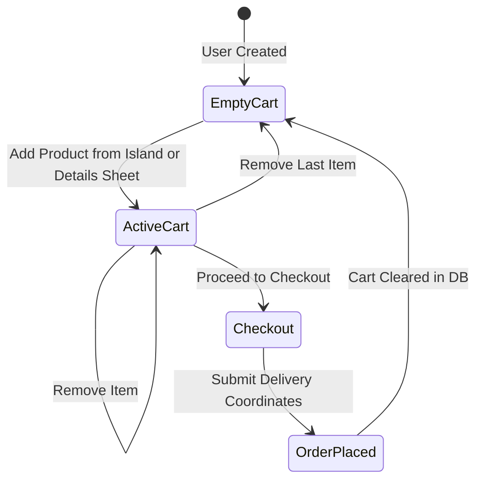
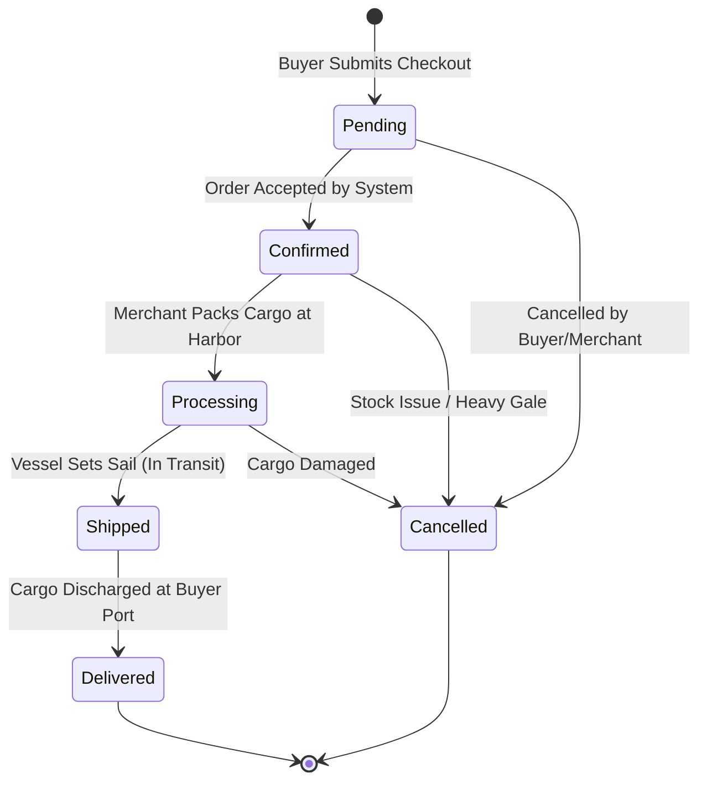

# 🏴‍☠️ 11_CART_AND_ORDER_SYSTEM — Cargo Manifest & Order Fulfillment

This document defines the architecture of the Cargo Manifest (Cart), the checkout transaction process, and the multi-merchant Order Fulfillment state machine.

---

## 1. Cart Architecture & Lifecycle



### 1.1 Migration from Frontend `localStorage` to MongoDB
* **Current State:** Cart operations are restricted to client-side `localStorage`. Items vanish if the user logs in from another terminal.
* **Target State:**
  1. Authenticated users interact with endpoints `/cart/add`, `/cart/update`, and `/cart/remove`.
  2. Every operation persists directly to the `Cart` collection in MongoDB.
  3. If a guest user adds items to `localStorage` before authenticating, upon login the client sends a one-time sync request (`POST /cart/sync`) to merge local items into their MongoDB cart.
  4. Real-time validation checks that requested quantities do not exceed available `stock` in `Product`.

---

## 2. Checkout Flow & Order Generation

```
[Review Cart] ──► [Input Delivery Coordinates] ──► [Confirm Doubloons Total]
                                                            │
                                                            ▼
                                              [Atomic Checkout Execution]
                                              1. Lock/Verify Stock
                                              2. Deduct Inventory
                                              3. Create Order Document
                                              4. Wipe Cart Document
                                              5. Emit Confirmation
```

1. **Payment Abstraction:** Payments are processed in native Doubloons (🪙). No third-party payment gateways (Stripe, PayPal) are integrated unless explicitly ordered.
2. **Snapshot Pricing:** When an order is placed, line items capture snapshot fields (`name`, `price`, `image`, `seller`) directly inside the order document. If a seller later changes the price of the product, historical orders remain unaffected.
3. **Atomic Stock Reduction:** Product stock is decremented at the moment of order placement. If an item runs out of stock while in checkout, the transaction aborts with an alert.

---

## 3. Order Status State Machine

Orders progress through an immutable lifecycle:



### 3.1 Permitted Transitions
* `pending` ➔ `confirmed` (System validation)
* `confirmed` ➔ `processing` (Merchant marks item being prepared)
* `processing` ➔ `shipped` (Merchant flags fleet departed)
* `shipped` ➔ `delivered` (Final dock receipt)
* `pending` / `confirmed` / `processing` ➔ `cancelled` (Order revoked; restores stock to Product)

---

## 4. Multi-Seller Order Coordination

Because Pirate-Civ is a marketplace, a single customer order may contain artifacts purchased from multiple independent merchants:

```
[Order #7842 - Total: 180 Doubloons]
  ├── Item 1: Seville Astrolabe (85 🪙)  ──> Seller: Captain Thorne (Astrolabe Atoll)
  └── Item 2: Toledo Boarding Sabre (95 🪙) ──> Seller: Master Morales (Cutlass Cove)
```

1. **Merchant Visibility Isolation:**
   - In the `/seller/orders` queue, Captain Thorne only sees Item 1.
   - Master Morales only sees Item 2.
2. **Overall Order Status:**
   - The master order status reflects the composite progress of all contained line items (or tracks per-item status).
