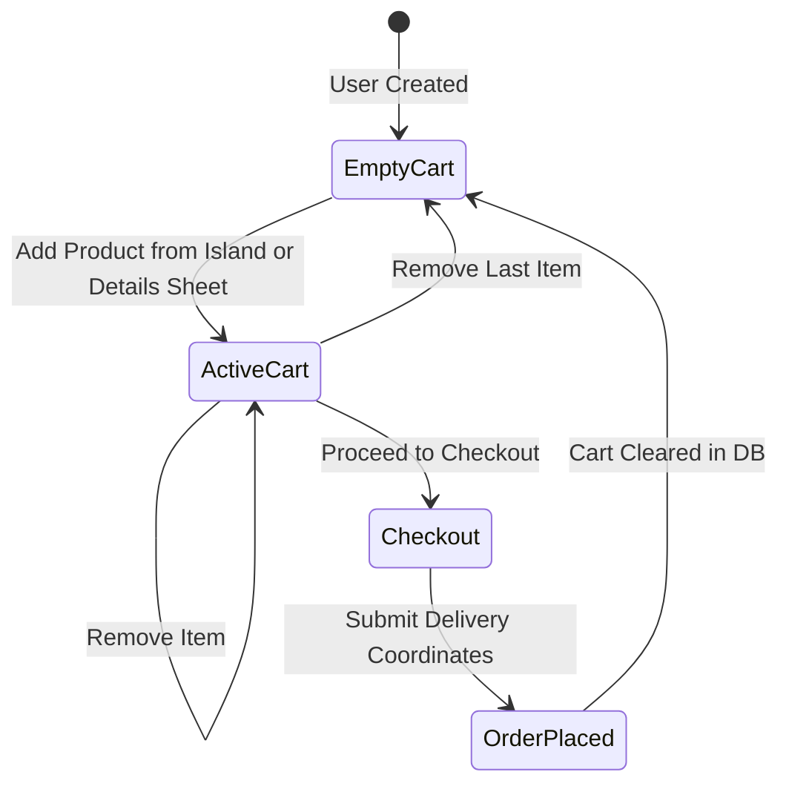
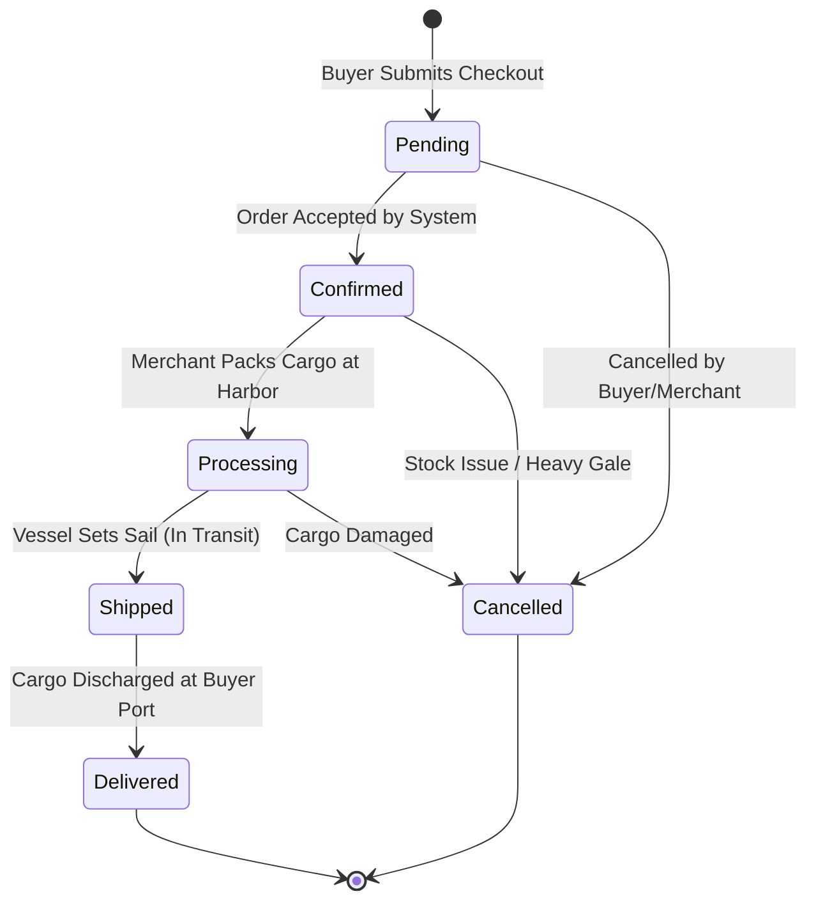

# 🏴‍☠️ 11_CART_AND_ORDER_SYSTEM — Cargo Manifest & Order Fulfillment

This document defines the architecture of the Cargo Manifest (Cart), the checkout transaction process, and the multi-merchant Order Fulfillment state machine.

---

## 1. Cart Architecture & Lifecycle



### 1.1 Database Foundation (Milestone 2.3)
* **Foundation Implemented:**
  1. `models/cart.js` implements persistent Cart schema linked to unified `User` (`user: { type: ObjectId, ref: 'User', unique: true }`).
  2. Embedded items structure: `items: [{ product: ObjectId (ref: 'Product'), quantity: Number (min: 1, integer) }]`.
  3. Built-in helpers: `cart.addItem(productId, quantity)` merges quantities without duplicating entries; `cart.removeItem(productId, quantity)` safely decrements or removes items; `Cart.findByUser(userId)` queries persistent cart.
  4. Server-Side Session Migration: When an explorer authenticates, `Cart.mergeSessionCart(user._id, preLoginSessionCart)` migrates guest session items into MongoDB, combining existing item quantities and safely filtering nonexistent products and invalid quantities without crashing.
  5. User Isolation: Cart is strictly bound to `req.user._id`; client-provided user IDs cannot override ownership.
* **Milestone 2.6 Verification:** Persistent Cart operations (`addItem`, `removeItem`, `mergeSessionCart`, `findByUser`) and Order queries were verified against the live migrated 32-product MongoDB catalog with confirmed stock invariance.

### 1.2 Persistent Buyer Cart Integration (Milestone 3.5 COMPLETE)
* **RESTful Cart Endpoints (`controller/cart.js`, `routes/web.js`):**
  - `GET /cart`: Serves SSR Cargo Hold Manifest (`views/cart.ejs`) or JSON payload if requested with `Accept: application/json` or AJAX.
  - `POST /cart/add`: Validates `productId`, checks product existence and availability in MongoDB, and adds/increments item in cart.
  - `POST /cart/update`: Adjusts item quantity (`action: "increase" | "decrease"` or explicit `quantity: number`). Safely removes item if quantity reaches 0.
  - `POST /cart/remove`: Discharges specific product from cargo hold (`quantity` decrement or complete removal).
  - `POST /cart/clear`: Jettisons all cargo from the active hold.
* **Optional Authentication & Session Fallback:**
  - Middleware `optionalAuth` populates `req.user` if signed `auth_token` and session match.
  - If unauthenticated, operations target `req.session.cart` with identical formatting and validation.
  - Upon user login, `Cart.mergeSessionCart(user._id, req.session.cart)` migrates session items into MongoDB.
* **Dedicated SSR Cargo Manifest View (`views/cart.ejs`):**
  - Renders itemized cargo table with product art, title, unit Doubloons valuation, quantity controls (+ / -), line total, and discharge action.
  - Summary sidebar displays item count, subtotal, trade port fee (exempt: 0 Doubloons), cargo total, checkout trigger ("Secure Cargo Hold"), jettison button ("Jettison All Cargo"), and link back to Sea Chart.
  - Includes themed empty state when hold is barren.
* **Frontend Sync (`public/js/island-store.js`):**
  - Topbar Doubloons pill and `#cartCountBadge` update dynamically.
  - Slide-out drawer (`#storeCartDrawer`) renders live server cart items.
  - All "Stow in Cargo Hold" buttons on island catalogs and product detail sheets trigger server-persisted add actions.
* **Security & Invariants:**
  - Authoritative prices calculated strictly from MongoDB `Product` records; client price overrides are rejected.
  - Sensitive user fields (`password`, `authSecretHash`, `googleId`) are strictly excluded from cart responses.
  - Zero stock deductions and zero orders created (Phase 5 boundary strictly maintained).
  - Milestone 3.6 Buyer Regression & UX Verification fully verified in real browser (multi-island stow, drawer, manifest, increment/decrement, remove, logout/login persistence, jettison all, empty state, 0 console errors).
  - Phase 4 / Phase 5 functionality is NOT implemented.

---

## 2. Checkout Flow & Order Generation

```
[Review Cart] ──► [Input Delivery Coordinates] ──► [Confirm Doubloons Total]
                                                            │
                                                            ▼
                                              [Atomic Checkout Execution]
                                              1. Lock/Verify Stock
                                              2. Deduct Inventory
                                              3. Create Order Document
                                              4. Wipe Cart Document
                                              5. Emit Confirmation
```

1. **Payment Abstraction:** Payments are processed in native Doubloons (🪙). No third-party payment gateways (Stripe, PayPal) are integrated. The model defines `paymentStatus: ["pending", "paid", "failed", "refunded"]` (default `"pending"`).
2. **Snapshot Pricing & Historical Integrity:** When an order is placed, line items capture immutable snapshots (`name`, `price`, `quantity`, `lineTotal`, `seller`, `image`, `product`) directly inside `order.items`. If a merchant subsequently alters product title, price, or description in `Product`, historical orders remain completely unaffected.
3. **Atomic Stock Reduction (Phase 5 Boundary):** In Milestone 2.4, the Order model database foundation is strictly decoupled from stock deduction; creating or updating orders does not mutate `Product.stock`. Atomic stock deduction and reservation will be implemented during Phase 5 checkout.
4. **Order Model Implementation (Milestone 2.4):**
   - Implemented in `models/order.js` linked to unified `User` (`buyer: ObjectId`).
   - Items schema captures product snapshot, positive integer quantity, and line total.
   - Automatically calculates `subtotal` and `totalDoubloons` from item line totals.
   - Requires shipping address (`portName`, default `islandCoordinates`, `recipientNotes`).
   - Strategic compound indexing: `{ buyer: 1, createdAt: -1 }` (buyer order history) and `{ "items.seller": 1, status: 1 }` (merchant fulfillment queues).
   - Query helpers: `Order.findByBuyer(buyerId)` and `Order.findBySeller(sellerId)`.

---

## 3. Order Status State Machine

Orders progress through an immutable lifecycle:



### 3.1 Permitted Transitions & Lifecycle Helpers
* `pending` ➔ `confirmed` (System validation)
* `confirmed` ➔ `processing` (Merchant marks item being prepared)
* `processing` ➔ `shipped` (Merchant flags fleet departed)
* `shipped` ➔ `delivered` (Final dock receipt)
* `pending` / `confirmed` / `processing` ➔ `cancelled` (Order revoked; will restore stock to Product in Phase 5)
* `delivered` and `cancelled` are terminal states (no further transitions permitted)
* **Lifecycle Helpers:**
  - `order.canTransitionTo(targetStatus)`: Validates if transition is permitted by `PERMITTED_STATUS_TRANSITIONS`.
  - `order.transitionTo(targetStatus)`: Advances status or throws Error if invalid.


---

## 4. Multi-Seller Order Coordination

Because Pirate-Civ is a marketplace, a single customer order may contain artifacts purchased from multiple independent merchants:

```
[Order #7842 - Total: 180 Doubloons]
  ├── Item 1: Seville Astrolabe (85 🪙)  ──> Seller: Captain Thorne (Astrolabe Atoll)
  └── Item 2: Toledo Boarding Sabre (95 🪙) ──> Seller: Master Morales (Cutlass Cove)
```

1. **Merchant Visibility Isolation:**
   - In the `/seller/orders` queue, Captain Thorne only sees Item 1.
   - Master Morales only sees Item 2.
2. **Overall Order Status:**
   - The master order status reflects the composite progress of all contained line items (or tracks per-item status).
