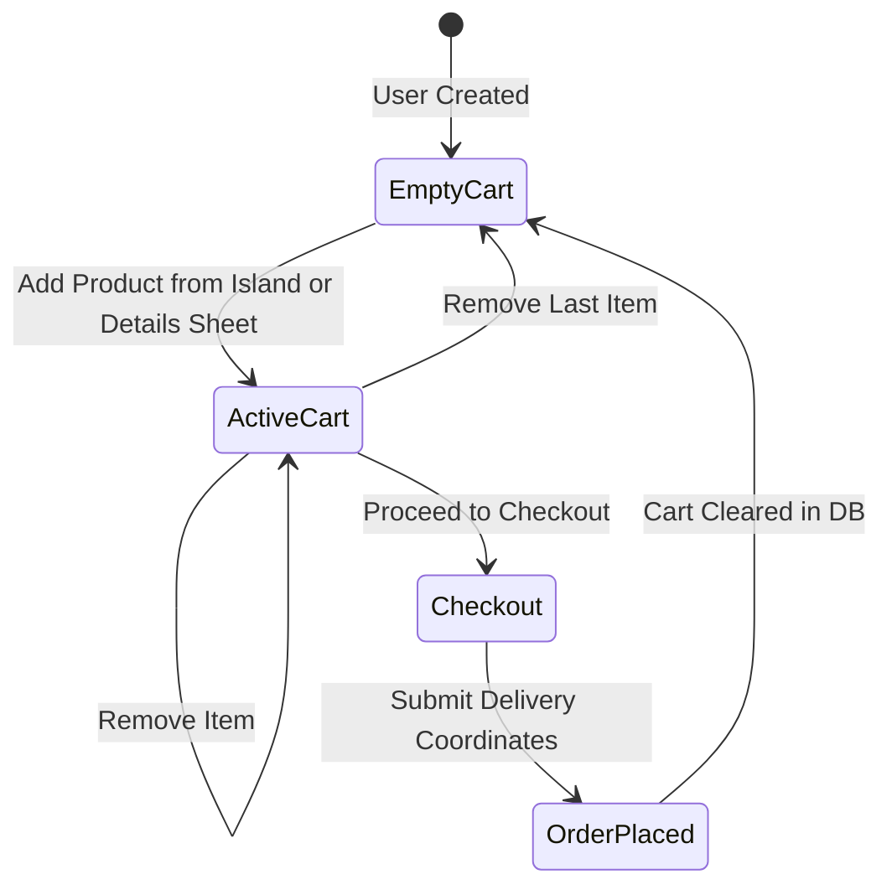
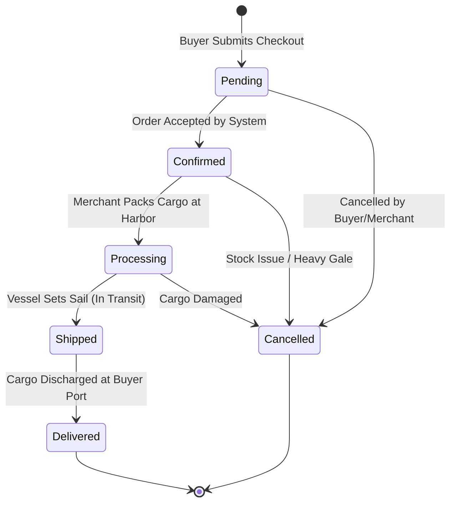

# 🏴‍☠️ 11_CART_AND_ORDER_SYSTEM — Cargo Manifest & Order Fulfillment

This document defines the architecture of the Cargo Manifest (Cart), the checkout transaction process, and the multi-merchant Order Fulfillment state machine.

---

## 1. Cart Architecture & Lifecycle



### 1.1 Database Foundation (Milestone 2.3)
* **Foundation Implemented:**
  1. `models/cart.js` implements persistent Cart schema linked to unified `User` (`user: { type: ObjectId, ref: 'User', unique: true }`).
  2. Embedded items structure: `items: [{ product: ObjectId (ref: 'Product'), quantity: Number (min: 1, integer) }]`.
  3. Built-in helpers: `cart.addItem(productId, quantity)` merges quantities without duplicating entries; `cart.removeItem(productId, quantity)` safely decrements or removes items; `Cart.findByUser(userId)` queries persistent cart.
  4. Server-Side Session Migration: When an explorer authenticates, `Cart.mergeSessionCart(user._id, preLoginSessionCart)` migrates guest session items into MongoDB, combining existing item quantities and safely filtering nonexistent products and invalid quantities without crashing.
  5. User Isolation: Cart is strictly bound to `req.user._id`; client-provided user IDs cannot override ownership.
* **Milestone 2.6 Verification:** Persistent Cart operations (`addItem`, `removeItem`, `mergeSessionCart`, `findByUser`) and Order queries were verified against the live migrated 32-product MongoDB catalog with confirmed stock invariance.

### 1.2 Persistent Buyer Cart Integration (Milestone 3.5 COMPLETE)
* **RESTful Cart Endpoints (`controller/cart.js`, `routes/web.js`):**
  - `GET /cart`: Serves SSR Cargo Hold Manifest (`views/cart.ejs`) or JSON payload if requested with `Accept: application/json` or AJAX.
  - `POST /cart/add`: Validates `productId`, checks product existence and availability in MongoDB, and adds/increments item in cart.
  - `POST /cart/update`: Adjusts item quantity (`action: "increase" | "decrease"` or explicit `quantity: number`). Safely removes item if quantity reaches 0.
  - `POST /cart/remove`: Discharges specific product from cargo hold (`quantity` decrement or complete removal).
  - `POST /cart/clear`: Jettisons all cargo from the active hold.
* **Optional Authentication & Session Fallback:**
  - Middleware `optionalAuth` populates `req.user` if signed `auth_token` and session match.
  - If unauthenticated, operations target `req.session.cart` with identical formatting and validation.
  - Upon user login, `Cart.mergeSessionCart(user._id, req.session.cart)` migrates session items into MongoDB.
* **Dedicated SSR Cargo Manifest View (`views/cart.ejs`):**
  - Renders itemized cargo table with product art, title, unit Doubloons valuation, quantity controls (+ / -), line total, and discharge action.
  - Summary sidebar displays item count, subtotal, trade port fee (exempt: 0 Doubloons), cargo total, checkout trigger ("Secure Cargo Hold"), jettison button ("Jettison All Cargo"), and link back to Sea Chart.
  - Includes themed empty state when hold is barren.
* **Frontend Sync (`public/js/island-store.js`):**
  - Topbar Doubloons pill and `#cartCountBadge` update dynamically.
  - Slide-out drawer (`#storeCartDrawer`) renders live server cart items.
  - All "Stow in Cargo Hold" buttons on island catalogs and product detail sheets trigger server-persisted add actions.
* **Security & Invariants:**
  - Authoritative prices calculated strictly from MongoDB `Product` records; client price overrides are rejected.
  - Sensitive user fields (`password`, `authSecretHash`, `googleId`) are strictly excluded from cart responses.
  - Zero stock deductions and zero orders created (Phase 5 boundary strictly maintained).
  - Milestone 3.6 Buyer Regression & UX Verification fully verified in real browser (multi-island stow, drawer, manifest, increment/decrement, remove, logout/login persistence, jettison all, empty state, 0 console errors).

### 1.3 Real-Time Stock Validation & Reconciliation (Milestone 5.1 COMPLETE)
* **Roadmap Reconciliation:**
  - Audit revealed that persistent database-backed cart operations, endpoints (`/cart/add`, `/cart/update`, `/cart/remove`, `/cart`, `/cart/clear`), and session merge (`Cart.mergeSessionCart`) were already established in Phase 2.3 and Phase 3.5.
  - The genuinely missing requirement discovered was **real-time product stock verification against MongoDB `Product.stock`** on add, update, and session migration.
* **Server-Side Validation Rules:**
  - **Exhausted Inventory:** When `product.stock <= 0` or `product.isAvailable !== true`, `POST /cart/add` immediately returns HTTP 400 (`Cannot stow "${product.name}": vault reserve is exhausted (out of stock)`).
  - **Stock Cap on Add:** When `(currentInCart + requestedQty) > product.stock`, returns HTTP 400 specifying remaining available units.
  - **Stock Cap on Update:** `POST /cart/update` (via `action: "increase"`, `delta: 1`, or explicit `quantity`) checks new target quantity against current `Product.stock`. If exceeded, returns HTTP 400 (`Cannot increase quantity beyond available vault reserve stock (${maxStock} units available)`).
  - **Session Merge Clamping:** In `Cart.mergeSessionCart`, incoming guest session quantities are clamped to `Math.min(requestedQty, currentStock - currentInCart)`. Zero or exhausted stock items are omitted safely without throwing errors.
* **UI Presentation:**
  - `views/cart.ejs` and `public/js/island-store.js` render live `Vault Reserve: X available` indicator for each line item in the Cargo Hold Manifest table.
  - Visual color highlights: Green for ample stock, amber/red warning for low stock (<= 3 units).
* **Strict Invariants:**
  - **Stock Invariance:** Cart additions and updates DO NOT decrement catalog stock (stock decrement is strictly reserved for Phase 5.2/5.3 checkout).
  - **Zero Orders:** Zero Order documents created during any cart operations.
  - **Single Cart Per User:** Enforced by MongoDB unique index `{ user: 1 }`.
* **Testing:**
  - 60/60 automated assertions in `scratch/test_milestone_5_1.js`.
  - 389 regression tests passed across Phase 4.5, 4.4, 3.6, and 3.5 suites.
  - Real browser verification verified stowing, quantity increment/decrement, multi-island addition, logout/login persistence, and clean jettison all with 0 console errors.

---

## 2. Checkout Flow & Order Generation

```
[Review Cart] ──► [Input Delivery Coordinates] ──► [Confirm Doubloons Total]
                                                            │
                                                            ▼
                                              [Atomic Checkout Execution]
                                              1. Lock/Verify Stock
                                              2. Deduct Inventory
                                              3. Create Order Document
                                              4. Wipe Cart Document
                                              5. Emit Confirmation
```

### 2.1 Milestone 5.2: Checkout Flow Implementation (COMPLETE)
* **Endpoints & Access Control (`controller/orders.js`, `routes/web.js`):**
  - `GET /checkout`: Serves the SSR Voyage Checkout & Cargo Clearance view (`views/checkout.ejs`) or JSON payload if queried with `Accept: application/json` or `?format=json`. Guarded with `[authMiddleware, requireBuyer]`. Unauthenticated requests redirect to `/login` (302), and non-buyer roles (sellers) receive HTTP 403 Forbidden.
  - `POST /checkout`: Server-side delivery coordinates validation and real-time inventory verification. Returns 400 on validation failure with safe value retention, and 200 on verification clearance.
* **Server-Authoritative Calculations:**
  - Authoritative product pricing, title, image, and available reserve are populated directly from MongoDB `Product` records. Client price or total overrides are strictly ignored.
  - Item Line Total: `Product.price * cartItem.quantity`
  - Subtotal: Sum of item line totals.
  - Trade Port Fee: 0 Doubloons (Exempt).
  - Grand Total: `Subtotal + Trade Port Fee`.
* **Delivery Coordinates Architecture:**
  - Matches the embedded `shippingAddressSchema` in `models/order.js`:
    - `portName`: Destination port / harbor quay (Required string, 2–120 characters, trimmed).
    - `islandCoordinates`: Navigational coordinates (String, max 120 characters, defaults to `"18°42'N, 64°31'W"`).
    - `recipientNotes`: Special harbor master delivery instructions (Optional string, max 500 characters, trimmed).
* **Real-Time Stock Revalidation:**
  - On both `GET /checkout` and `POST /checkout`, every stowed cargo item is checked against current MongoDB `Product` state:
    - Verifies product existence in catalog.
    - Verifies `product.isAvailable !== false`.
    - Verifies requested quantity does not exceed current `Product.stock`.
    - If any product became unavailable or exceeded stock, returns clear, human-readable feedback identifying the affected item without crashing.
* **Milestone 5.2 Order Boundary:**
  - In Milestone 5.2, checkout validates and clears delivery coordinates without prematurely creating `Order` documents or decrementing `Product.stock`.
  - Transactional order placement, state initialization (`pending`), atomic inventory reduction, and cart clearance belong strictly to Milestone 5.3.

### 2.2 Order Generation & Model Architecture (Milestone 2.4 Foundation)
1. **Payment Abstraction:** Payments are processed in native Doubloons (🪙). No third-party payment gateways (Stripe, PayPal) are integrated. The model defines `paymentStatus: ["pending", "paid", "failed", "refunded"]` (default `"pending"`).
2. **Snapshot Pricing & Historical Integrity:** When an order is placed, line items capture immutable snapshots (`name`, `price`, `quantity`, `lineTotal`, `seller`, `image`, `product`) directly inside `order.items`. If a merchant subsequently alters product title, price, or description in `Product`, historical orders remain completely unaffected.
3. **Atomic Stock Reduction (Phase 5 Boundary):** In Milestone 2.4, the Order model database foundation is strictly decoupled from stock deduction; creating or updating orders does not mutate `Product.stock`. Atomic stock deduction and reservation will be implemented during Phase 5 checkout.
4. **Order Model Implementation (Milestone 2.4):**
   - Implemented in `models/order.js` linked to unified `User` (`buyer: ObjectId`).
   - Items schema captures product snapshot, positive integer quantity, and line total.
   - Automatically calculates `subtotal` and `totalDoubloons` from item line totals.
   - Requires shipping address (`portName`, default `islandCoordinates`, `recipientNotes`).
   - Strategic compound indexing: `{ buyer: 1, createdAt: -1 }` (buyer order history) and `{ "items.seller": 1, status: 1 }` (merchant fulfillment queues).
   - Query helpers: `Order.findByBuyer(buyerId)` and `Order.findBySeller(sellerId)`.

---

## 3. Order Status State Machine

Orders progress through an immutable lifecycle:



### 3.1 Permitted Transitions & Lifecycle Helpers
* `pending` ➔ `confirmed` (System validation)
* `confirmed` ➔ `processing` (Merchant marks item being prepared)
* `processing` ➔ `shipped` (Merchant flags fleet departed)
* `shipped` ➔ `delivered` (Final dock receipt)
* `pending` / `confirmed` / `processing` ➔ `cancelled` (Order revoked; will restore stock to Product in Phase 5)
* `delivered` and `cancelled` are terminal states (no further transitions permitted)
* **Lifecycle Helpers:**
  - `order.canTransitionTo(targetStatus)`: Validates if transition is permitted by `PERMITTED_STATUS_TRANSITIONS`.
  - `order.transitionTo(targetStatus)`: Advances status or throws Error if invalid.


---

## 4. Multi-Seller Order Coordination & Merchant Console (Milestone 4.4 COMPLETE)

Because Pirate-Civ is an archipelago marketplace, a single customer order may contain artifacts purchased from multiple independent merchants:

```
[Order #7842 - Total: 180 Doubloons]
  ├── Item 1: Seville Astrolabe (85 🪙)     ──> Seller: Captain Thorne (Astrolabe Atoll)
  └── Item 2: Toledo Boarding Sabre (95 🪙) ──> Seller: Master Morales (Cutlass Cove)
```

1. **Merchant Visibility Isolation (`GET /seller/orders`, `GET /seller/orders/:orderId`):**
   - In `/seller/orders`, Captain Thorne only sees Item 1 and a merchant subtotal of 85 Doubloons.
   - Master Morales only sees Item 2 and a merchant subtotal of 95 Doubloons.
   - Other merchants' line items, unit prices, quantities, and line totals are completely stripped server-side.
2. **Access Control & RBAC Enforcement:**
   - Routes are strictly guarded with `[authMiddleware, requireSeller]`.
   - Seller identity is derived immutably from `req.user._id`.
   - Cross-seller access attempts to orders containing zero items for the requesting seller are rejected with HTTP 403.
3. **Historical Snapshot Integrity:**
   - Historical item records (`name`, `price`, `quantity`, `lineTotal`, `image`) come directly from `order.items` embedded snapshots.
   - Modifying a `Product` in the catalog never overwrites past order records.
4. **Lifecycle State Progression (`POST /seller/orders/:orderId/status`):**
   - Valid transitions (`pending` ➔ `confirmed` ➔ `processing` ➔ `shipped` ➔ `delivered`, with safe cancellations) are enforced via `order.canTransitionTo()` and `order.transitionTo()`.
   - Invalid or terminal transitions are rejected safely with clear human-readable feedback.
   - Status is managed at the Order level in `models/order.js`; transitions advance the unified voyage manifest.

---

## 5. Order Generation Flow & State Machine (Milestone 5.3 COMPLETE)

Milestone 5.3 completes the bridge between the buyer's persistent Cart and authoritative Order documents in MongoDB.

### 5.1 Architecture & Write Ordering Sequence

Because the local development environment runs a standalone MongoDB instance (without replica sets), multi-document ACID transactions are not available. To guarantee high reliability and avoid corrupted state without pseudo-transaction abstractions, the system enforces a strictly ordered write flow:

```
[Buyer Clicks "Sign Manifest & Dispatch Fleet"]
                     │
                     ▼
  [STEP A: FINAL SERVER-SIDE VALIDATION]
   • Re-read persistent Cart from MongoDB (fail if empty)
   • Re-read every Product record live from MongoDB
   • Re-verify product availability (isAvailable === true)
   • Re-verify stock sufficiency (stock > 0 and stock >= quantity)
   • Calculate authoritative pricing: subtotal + trade port fee (0) = totalDoubloons
   • Validate delivery coordinates (portName 2-120 chars, coordinates, notes)
   • ZERO DATABASE WRITES OCCUR IF ANY VALIDATION FAILS
                     │
                     ▼ (Validation Passes)
  [STEP B: CREATE ORDER DOCUMENT]
   • Insert new Order with buyer = req.user._id, status = 'pending', paymentStatus = 'pending'
   • Embed historical immutable snapshots (product, seller, name, price, quantity, lineTotal, image)
   • Persist shippingAddress
                     │
                     ▼ (Order Created Successfully)
  [STEP C: CONDITIONAL STOCK DEDUCTIONS]
   • Deduct purchased quantities per document using conditional atomic query:
     { _id: prodId, stock: { $gte: qty }, isAvailable: true } ➔ { $inc: { stock: -qty } }
   • Ensures stock never dips into negative numbers
                     │
                     ▼ (Stock Decremented Successfully)
  [STEP D: CLEAR PERSISTENT BUYER CART]
   • Reset buyer's cart: cart.items = []
   • Save cleared cart to MongoDB
                     │
                     ▼
  [STEP E: DISPATCH RESPONSE]
   • Browser: Redirect to /orders/:orderId?placed=1 (renders views/order-confirmation.ejs)
   • API / JSON: Return HTTP 201 Created with order payload
```

### 5.2 Standalone Demo Architecture Limitation (Non-Transactional Flow)

> **Important Architecture Notice:** Phase 5.3 currently uses a validated non-transactional order-generation flow because the local demo MongoDB deployment is standalone. Production deployment should use a MongoDB replica set or sharded cluster with ACID transactions for fully atomic order creation, stock deduction, and cart clearing.

This implementation intentionally does NOT claim ACID atomicity and does NOT call `session.startTransaction()`. The careful write ordering guarantees that:
1. Failed validations trigger ZERO writes and preserve the buyer's cart intact.
2. An already-cleared cart prevents duplicate order generation.
3. Live product prices are always authoritative over client-submitted values.

### 5.3 Double-Submission Protection
- **Client-Side:** The checkout submit buttons (`#btnConfirmCheckout` and `#btnSidebarSeal`) automatically disable upon form submission, preventing rapid double-clicks.
- **Server-Side:** Because the cart is cleared in Step D, any immediate duplicate HTTP request receives an empty cart error (HTTP 400: `Cannot place order: cargo hold is empty`) and generates no second order.

### 5.4 Historical Snapshot Immutability
Order items snapshot product name, unit price, quantity, line total, and merchant attribution at checkout time. Subsequent price changes, catalog renaming, or product deletions never mutate completed orders.

### 5.5 Buyer Order Manifest View (`GET /orders/:orderId`)
Authenticated buyers can view their generated voyage manifests at `/orders/:orderId`. Access is strictly scoped to the authenticated buyer (`buyer: req.user._id`), preventing cross-user data leakage.


